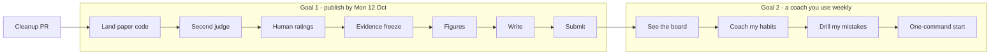

# Plan — one goal at a time

Rewritten 2026-09-13. The original Phase 0–6 roadmap (Chroma, Qwen2.5-3B, a hosted public site)
is in git history. It served its purpose, and most of it was either built or deliberately
dropped. This version replaces it with two finishable goals, done **one after the other**.

## Where the project stands

**Built and working**

| Layer | What it does |
|---|---|
| `engine/` | Stockfish analysis at a fixed depth; move quality from win-probability loss; keeps the engine's line |
| `coach/` | a strictly grounded facts block and prompt; Ollama client; the `qwen-coach-8b-v2` fine-tune or `qwen3:8b` |
| `memory/` | SQLite history of your games; tags hung material, dropped pawns, missed captures, forks, back-rank; profile with a noise-aware trend |
| `api/` | sync chess.com → dashboard → game list → game page with mistakes → "coach this game", with a grounding note |
| `eval/`, `training/` | held-out set, grounding metric plus its audit, claim checkers, LLM judge, distillation, QLoRA, equivalence testing |

Your data: 53 `mshah509` games (25 Jun – 6 Sep 2026). Tagged mistakes so far: hanging material
55, dropped pawns 47, missed captures 35, forks 25.

**What the research found** (details in `docs/experiments/`)

1. The deterministic grounding metric was wrong in both directions. It was saturated (18/29 games
   at the ceiling) and blind to inverted claims, yet over-fired on square names in prose
   (84–94% of all flags). Correcting it reversed two earlier conclusions.
2. Claim checkers that replay the game: 0/467 false positives on teacher rows. Every flagged
   held-out game was judged factual 2/5. Recall is low.
3. Distillation reproduced its base model's judged quality (factual 3.72 vs 3.72) and improved
   citation hygiene. It did not exceed the base model. The teacher scores 4.97, so the headroom is real.

**Not finished**

- Paper: no draft yet. The cross-judge check (Gate 3) has not run. The human-rating sheet was
  built today with 0 ratings. The paper's code is on `paper/grounding-audit`, which has no PR.
  The sprint's TMLR date (14 Sep) cannot be met.
- App: you can read about a game, but you can't see the board. Coaching covers one game at a
  time, never your habits across games, and nothing makes you practise.

## The rule

**One goal active at a time.** Each goal has a finish line, and a list of what it is *not*
doing. Anything new goes on the "later" list, not into the current goal. Everything that slipped
on this project slipped by adding "one more thing worth auditing".

**Recommended order: paper first, time-boxed to four weeks, then the app.** The paper is mostly
evidence already collected, and it gets harder to verify over time. Gemini 2.5 already refuses
new keys, and the Opus judge behind every number may be next. The app has no deadline, and it
already runs. If you would rather use a coach this month, swap the order. Pick one either way;
don't run both.

**Freeze while the paper is open:** `SYSTEM_PROMPT`, `format_report_facts` and `eval/`. They
define the numbers in the paper. New app prompts go in new functions.

---

## Goal 1 — Publish the research

**Finish line:** arXiv preprint (cs.CL) and TMLR submission, with the repo tagged `paper-v1`.
Target **Mon 12 Oct 2026**.

**Paper:** *Grounded in What? Auditing Deterministic Grounding Metrics for Free-Form Chess
Coaching*. The audit (§4) leads, the claim checkers (§5) follow, and the distillation result
(§6) is the second act. Outline: `docs/experiments/2026-08-30-paper-outline.md` on the paper
branch.

| # | Step | Done when | By |
|---|---|---|---|
| P1 | Land the paper code: rebase `paper/grounding-audit` on master and open a PR (`equivalence`, `rejudge`, `human_rating`, outline, gap analysis) | merged; bare `pytest` green | Tue 15 Sep |
| P2 | **Gate 3, second judge.** `eval.rejudge` over stored coaching for both arms; per-axis agreement with Opus; rerun `eval.equivalence` under the second judge. Disclose that `gemini-3.6-flash` is weaker than Opus | `docs/experiments/…-gate3-cross-judge.md` committed | Fri 18 Sep |
| P3 | **Human ratings.** You plus one chess-playing rater, 20 blinded items (`eval/human/round1`). If no second rater by Fri 18 Sep, ship with one rater and state it as a limitation | `ratings.csv` filled; human ↔ judge agreement computed | Sun 20 Sep |
| P4 | **Evidence freeze.** Tag `evidence-freeze`. From here: no new experiments, no expanding the held-out set (n=29 with the stated bound) | tag pushed | Sun 20 Sep |
| P5 | Figures and tables as committed scripts under `eval/figures/`: F2 ceiling pile-up, F3 grounding vs factual, F4 TOST forest plot, T1 corrected scoreboard, T2 checker precision, T3 ablation | each regenerates from committed reports | Sun 27 Sep |
| P6 | Write, in this order: §4 audit → §5 checkers → §6 distillation → §7 threats → §3 setup → §2 related work → §1 intro → abstract last | full draft in `paper/` | Sun 4 Oct |
| P7 | Hostile read (write the three reviews you fear, answer each in the text); fresh-clone reproduction with `paper/REPRODUCE.md`; tag `paper-v1`; submit | submitted | Mon 12 Oct |

**Not in this goal:** a v3 dataset, another fine-tune, held-out expansion, positional motifs,
new audits, app features.

**Budget:** P2 costs little or nothing on the Gemini key. P1–P7 need no Anthropic spend, because
every Opus score is already stored.

---

## Goal 2 — A coach you actually use

**Finish line:** once a week you open the app. It pulls your new games, shows you the one habit
costing you most with board positions from your own games, coaches you on it, and drills you on
positions you got wrong before. Local, single-user.

Each step is one small PR, branched from master.

| # | Step | Why | Size |
|---|---|---|---|
| A1 | **See the board.** Render `fen_before` of every mistake as SVG with `chess.svg`, server-side, still zero JS. Arrows show the move you played and the engine's move | coaching in notation alone isn't usable | S |
| A2 | **"Coach my habits" page.** For your top 1–3 recurring motifs, take 3–5 example positions from your own games. The coach explains the pattern using those examples, and the checker's allowed moves are exactly those examples' moves. Store it with its facts, like per-game coaching | the actual ask: coaching on *past mistakes*, not one game | M |
| A3 | **Drill your own mistakes.** Show a past `fen_before`; you type a move (a plain form); Stockfish grades it by win-probability loss; spaced repetition in a `drills` table | turns being coached into improving; deterministic, no LLM | M |
| A4 | **One-command start.** `make app` checks Stockfish, Ollama and the model, starts the server, and syncs new games when the dashboard opens | removes the eight-step setup | S |
| A5 | **Decide the coach model** (below), then make it a setting | quality ceiling | S |

**Decision needed before A2: which model coaches you?**
- Local `qwen-coach-8b-v2` or `qwen3:8b`: free, private, judged factual **3.72/5**.
- Claude over the API: the teacher scored **4.97/5** on the same rubric, at roughly cents per
  game. `eval.backends` already talks to it.

**Not in this goal:** hosting, accounts, other users, Lichess, vector search, periodic
re-fine-tuning, positional motifs. 161 of your 299 stored mistakes (54%) carry no motif tag;
revisit that only after you have used A1–A3 for a month.

---

## Later (parked, not forgotten)

- Positional motifs from Stockfish's per-piece NNUE output (split measurement from classification first).
- Position embeddings for "find past positions like this one" (ChessCLIP).
- A v1 amplification check for the class-C finding. It's free, but it's a new experiment, so it waits for after the paper.
- Hosting for other players.

## Housekeeping (needs your OK)

- 43 remote branches on GitHub are old PR heads (42 already merged). Delete them, keeping `master`
  and `paper/grounding-audit`, along with the 43 matching local branches.
- `models/` holds local symlinks to GGUFs in `~/Downloads` (ablation arms), and `data/distill/`
  holds intermediate chunk files. All are gitignored and safe to remove once the paper is submitted.
