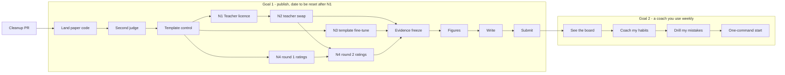

# Plan — one goal at a time

Rewritten 2026-09-13; status and next steps updated 2026-09-20. The original Phase 0–6 roadmap (Chroma, Qwen2.5-3B, a hosted public site)
is in git history. It served its purpose, and most of it was either built or deliberately
dropped. This version replaces it with two finishable goals, done **one after the other**.

## Where the project stands

**Built and working**

| Layer | What it does |
|---|---|
| `engine/` | Stockfish analysis at a fixed depth; move quality from win-probability loss; keeps the engine's line |
| `coach/` | a strictly grounded facts block and prompt; Ollama client; the `qwen-coach-8b-v2` fine-tune or `qwen3:8b` |
| `memory/` | SQLite history of your games; tags hung material, dropped pawns, missed captures, forks, back-rank; profile with a noise-aware trend |
| `api/` | sync chess.com → dashboard → game list → game page with mistakes → "coach this game", with a grounding note |
| `eval/`, `training/` | held-out set, grounding metric plus its audit, claim checkers, LLM judge, distillation, QLoRA, equivalence testing |

Your data: 53 `mshah509` games (25 Jun – 6 Sep 2026). Tagged mistakes so far: hanging material
55, dropped pawns 47, missed captures 35, forks 25.

**What the research found** (details in `docs/experiments/`)

1. The deterministic grounding metric was wrong in both directions. It was saturated (18/29 games
   at the ceiling) and blind to inverted claims, yet over-fired on square names in prose
   (84–94% of all flags). Correcting it reversed two earlier conclusions.
2. Claim checkers that replay the game: 0/467 false positives on teacher rows. Every flagged
   held-out game was judged factual 2/5. Recall is low.
3. Distillation reproduced its base model's judged quality (factual 3.72 vs 3.72) and improved
   citation hygiene. It did not exceed the base model. The teacher scores 4.97, so the headroom is real.

**Since 13 Sep** (all merged to `master`)

- **Gate 3 ran** (#62). Under a second judge (`gemini-3.1-pro-preview`) the distillation tie does not
  survive: factual is +0.41 for the fine-tune (not significant at n = 29), and the two judges disagree
  on how much invented narrative should cost. `docs/experiments/2026-09-13-gate3-cross-judge.md`.
- **Human-rating tooling landed** (#65, #66): multi-rater consensus, inter-rater agreement, and a
  29-item round-1 sample, stratified by arm within each bucket. **`eval/human/round1/ratings.csv`
  still has 0 ratings.**
- **Template control added** (#67): a coach with no model in it, built from the same facts block.
  Factual 5.00 against 3.72 (Opus) and 2.86–3.28 (Gemini) for the 8B arms, and overall 4.22 vs
  4.14–4.17. A script ties or beats both 8B models on this rubric; the LLM's edge is actionability.
  `docs/experiments/2026-09-20-template-control.md`.

**Not finished**

- **Blocker: the teacher licence.** Anthropic's terms prohibit using Outputs "as training targets
  for models" and "models designed for open-ended text generation" without written permission
  (Help Center, updated 16 Mar 2026; Commercial Terms §D.4). The v2 fine-tune was trained on Opus
  rows. Nothing in the repo addresses this. It must be resolved before any submission; see
  "Next steps".
- Paper: no draft yet. Human ratings are 0. The evidence freeze (P4) and the TMLR date have both
  slipped past their dates.
- App: you can read about a game, but you can't see the board. Coaching covers one game at a
  time, never your habits across games, and nothing makes you practise.

## Next steps (picked up from 20 Sep)

N1, N2, N3 and N4 round 1 can all start now and run in parallel; none waits on another. Later steps wait on the gates. Each gate decides whether the next step is needed.

**N1. Resolve the teacher licence (blocks everything below that touches distillation).**
Ask Anthropic for written permission (describe: academic chess-coaching study, 8B student, no release
of the distilled data) and keep the reply. Do not release the distilled dataset either way; release
generation prompts only. State the teacher, and the permission, in the paper. Do not omit or rename it.

**N2. In parallel, test an open-weights teacher (free of the licence question).**
Shortlist by licence first: DeepSeek-V4 (MIT), GLM-5.3, Kimi K3, and check each licence text yourself.
`openrouter.ai/collections/distillable-models` lists models whose terms allow distillation. A hosted API
has its own terms, separate from the weights licence. Run each candidate on the 29 held-out games with
the same prompt, judge with Opus (evaluation is not restricted), and run the claim checkers.
**Gate:** judged factual ≥ ~4.5 and zero claim violations. If none clears it, the distilled fine-tune
is not reproducible licence-free, and the paper leans on the audit, the checkers and the template
control (§4, §5, and the new control), with the fine-tune as an appendix.

**N3. Fine-tune on the template's output (no teacher, no licence issue, ~$1.20 GPU). Runnable now, in parallel with N1 and N2.**
The missing attribution control: are v2's gains from the teacher's text or from the row *shape*? The
shape-vs-volume ablation already pointed at shape. Template rows are free, so this also gives a
data-scale ablation (1k / 5k / 20k rows) with no teacher spend. Read the result against v2 and the
prompted base, not in absolute terms: the student can at best match the template. Its outputs do not
depend on the teacher, so it is a stable arm for human rating (N4, round 2).

**N4. Human ratings (P3), now decisive. Round 1 can start now.** Gate 3 made human judgement the
tiebreak between two judges that weigh severity differently. Use at least two raters, state each
rater's strength, and compute human ↔ judge agreement.

Arms depend on the teacher, so rate in two rounds. Otherwise ratings of a fine-tune that may not
survive the licence answer are wasted.

- **Round 1 (now): teacher-independent arms only** — prompted `qwen3:8b` and the template coach. The
  current sample (`eval/human/round1`) holds 15 v2 and 14 prompted-base items, so rebuild it to swap
  v2 out for the template report. Check how the arm-balanced stratification behaves with the new pair.
- **Round 2 (after N1 and N2 settle which fine-tune is real):** the surviving fine-tune (v2 if
  Anthropic says yes, else the open-weights-teacher fine-tune) and the template-trained model from N3.
- **Anchors:** repeat 4–5 prompted-base items in both rounds, so a calibration shift between sessions
  shows up and can be corrected. Use the same raters for both rounds.

**N5. Fix before the figures script (P5) reads any report.**
Older re-judged reports (`*__gemini31pro.json`) still carry a stale `aggregate` block from before the
`eval.rejudge` fix. Their per-game rubrics are correct. Have the figures script recompute from `games`,
not `aggregate`. Do not report `identifies_worst_move`: it scores the game's worst move for either side,
but the facts block lists only the coached side's mistakes, so 5 of the template's 8 misses are moves no
coach could cite.

**N6. Freeze and write.** Only after N1 is answered and N2/N3 are run or dropped: evidence freeze
(P4), figures (P5), draft (P6), hostile read and submit (P7). Move the target date once N1 has an
answer; 12 Oct is not realistic without one.

## The rule

**One goal active at a time.** Each goal has a finish line, and a list of what it is *not*
doing. Anything new goes on the "later" list, not into the current goal. Everything that slipped
on this project slipped by adding "one more thing worth auditing".

**Recommended order: paper first, time-boxed to four weeks, then the app.** The paper is mostly
evidence already collected, and it gets harder to verify over time. Gemini 2.5 already refuses
new keys, and the Opus judge behind every number may be next. The app has no deadline, and it
already runs. If you would rather use a coach this month, swap the order. Pick one either way;
don't run both.

**Freeze while the paper is open:** `SYSTEM_PROMPT`, `format_report_facts` and `eval/`. They
define the numbers in the paper. New app prompts go in new functions.

---

## Goal 1 — Publish the research

**Finish line:** arXiv preprint (cs.CL) and TMLR submission, with the repo tagged `paper-v1`.
Target **Mon 12 Oct 2026**.

**Paper:** *Grounded in What? Auditing Deterministic Grounding Metrics for Free-Form Chess
Coaching*. The audit (§4) leads, the claim checkers (§5) follow, and the distillation result
(§6) is the second act. Outline: `docs/experiments/2026-08-30-paper-outline.md` on the paper
branch.

| # | Step | Done when | By |
|---|---|---|---|
| P1 | Land the paper code: rebase `paper/grounding-audit` on master and open a PR (`equivalence`, `rejudge`, `human_rating`, outline, gap analysis) | merged; bare `pytest` green. **Done** (#61) | Tue 15 Sep |
| P2 | **Gate 3, second judge.** `eval.rejudge` over stored coaching for both arms; per-axis agreement with Opus; rerun `eval.equivalence` under the second judge. Disclose that `gemini-3.6-flash` is weaker than Opus | `docs/experiments/…-gate3-cross-judge.md` committed. **Done** (#62) | Fri 18 Sep |
| P3 | **Human ratings.** You plus one chess-playing rater, 29 blinded items (`eval/human/round1`, resized from 20). If no second rater by Fri 18 Sep, ship with one rater and state it as a limitation | `ratings.csv` filled; human ↔ judge agreement computed. **Tooling done, 0 ratings; slipped (N4)** | Sun 20 Sep |
| P4 | **Evidence freeze.** Tag `evidence-freeze`. From here: no new experiments, no expanding the held-out set (n=29 with the stated bound) | tag pushed. **Slipped: now after N1 (N6)** | Sun 20 Sep |
| P5 | Figures and tables as committed scripts under `eval/figures/`: F2 ceiling pile-up, F3 grounding vs factual, F4 TOST forest plot, T1 corrected scoreboard, T2 checker precision, T3 ablation | each regenerates from committed reports | Sun 27 Sep |
| P6 | Write, in this order: §4 audit → §5 checkers → §6 distillation → §7 threats → §3 setup → §2 related work → §1 intro → abstract last | full draft in `paper/` | Sun 4 Oct |
| P7 | Hostile read (write the three reviews you fear, answer each in the text); fresh-clone reproduction with `paper/REPRODUCE.md`; tag `paper-v1`; submit | submitted | Mon 12 Oct |

**Not in this goal:** a v3 dataset of Opus rows, held-out expansion, positional motifs, new audits,
app features. Exception, gated on N1/N2: the template-target fine-tune and the open-weights teacher
test in "Next steps", which exist to answer the licence question and the attribution control.

**Budget:** P2 cost little on the Gemini key. P1–P7 need no further Anthropic spend beyond judging any
new arm (the template arm was 29 Opus calls, roughly $0.40); every earlier Opus score is already stored.

---

## Goal 2 — A coach you actually use

**Finish line:** once a week you open the app. It pulls your new games, shows you the one habit
costing you most with board positions from your own games, coaches you on it, and drills you on
positions you got wrong before. Local, single-user.

Each step is one small PR, branched from master.

| # | Step | Why | Size |
|---|---|---|---|
| A1 | **See the board.** Render `fen_before` of every mistake as SVG with `chess.svg`, server-side, still zero JS. Arrows show the move you played and the engine's move | coaching in notation alone isn't usable | S |
| A2 | **"Coach my habits" page.** For your top 1–3 recurring motifs, take 3–5 example positions from your own games. The coach explains the pattern using those examples, and the checker's allowed moves are exactly those examples' moves. Store it with its facts, like per-game coaching | the actual ask: coaching on *past mistakes*, not one game | M |
| A3 | **Drill your own mistakes.** Show a past `fen_before`; you type a move (a plain form); Stockfish grades it by win-probability loss; spaced repetition in a `drills` table | turns being coached into improving; deterministic, no LLM | M |
| A4 | **One-command start.** `make app` checks Stockfish, Ollama and the model, starts the server, and syncs new games when the dashboard opens | removes the eight-step setup | S |
| A5 | **Decide the coach model** (below), then make it a setting | quality ceiling | S |

**Decision needed before A2: which model coaches you?**
- Local `qwen-coach-8b-v2` or `qwen3:8b`: free, private, judged factual **3.72/5**.
- Claude over the API: the teacher scored **4.97/5** on the same rubric, at roughly cents per
  game. `eval.backends` already talks to it.

**Not in this goal:** hosting, accounts, other users, Lichess, vector search, periodic
re-fine-tuning, positional motifs. 161 of your 299 stored mistakes (54%) carry no motif tag;
revisit that only after you have used A1–A3 for a month.

---

## Later (parked, not forgotten)

- Positional motifs from Stockfish's per-piece NNUE output (split measurement from classification first).
- Position embeddings for "find past positions like this one" (ChessCLIP).
- A v1 amplification check for the class-C finding. It's free, but it's a new experiment, so it waits for after the paper.
- Hosting for other players.

## Housekeeping (needs your OK)

- 43 remote branches on GitHub are old PR heads (42 already merged). Delete them, keeping `master`
  and `paper/grounding-audit`, along with the 43 matching local branches.
- `models/` holds local symlinks to GGUFs in `~/Downloads` (ablation arms), and `data/distill/`
  holds intermediate chunk files. All are gitignored and safe to remove once the paper is submitted.
